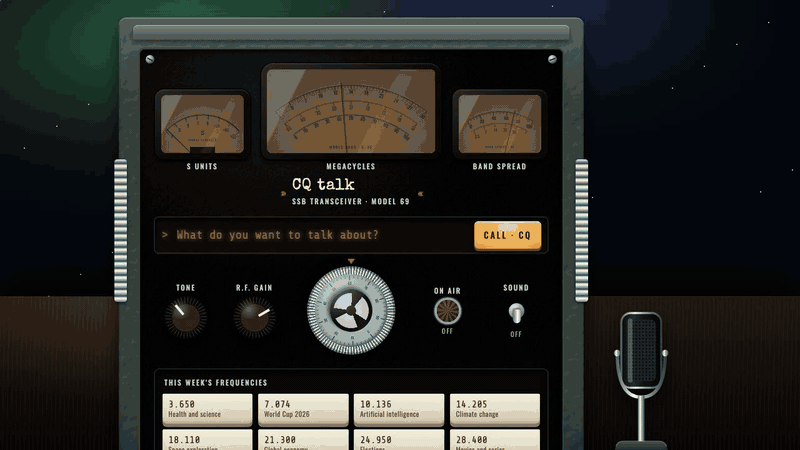
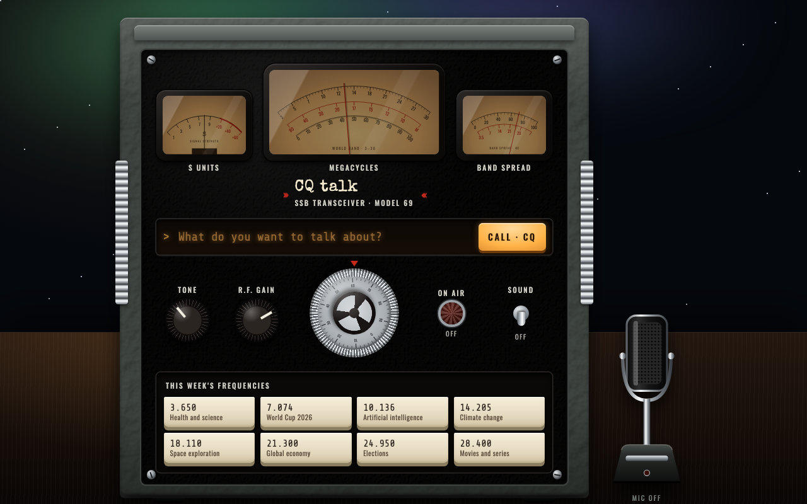
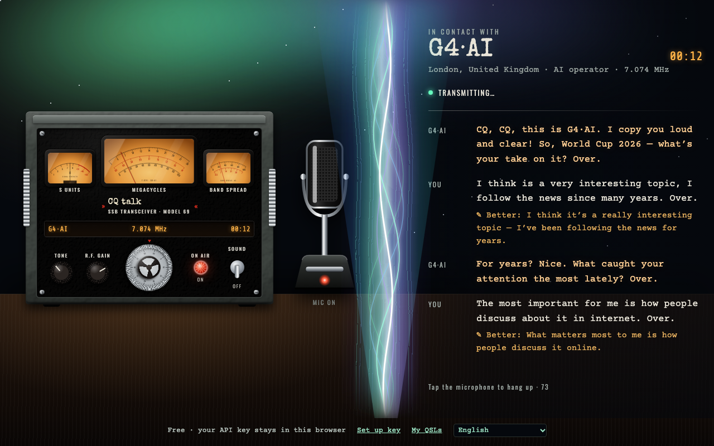
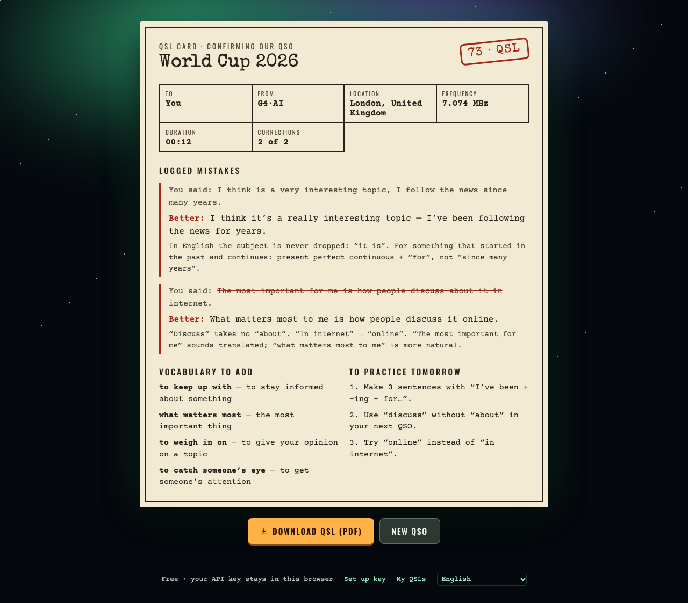
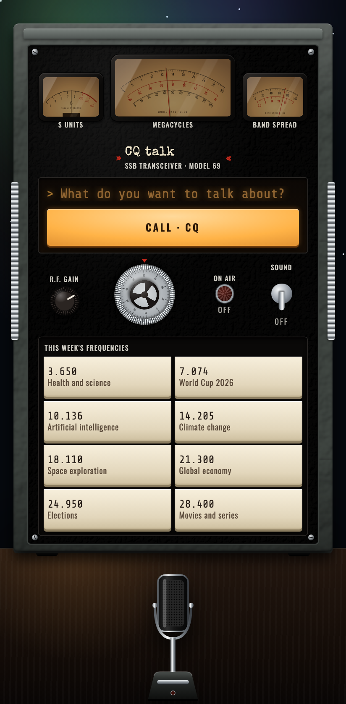
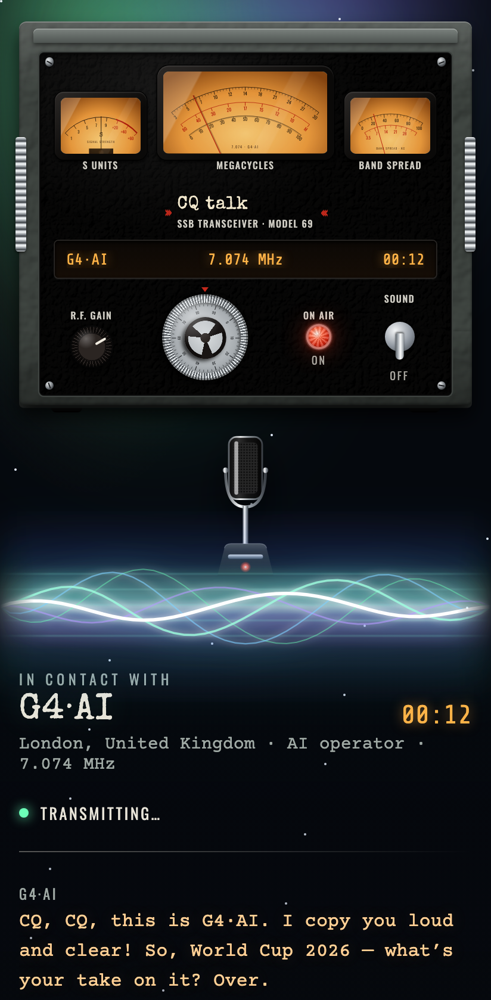
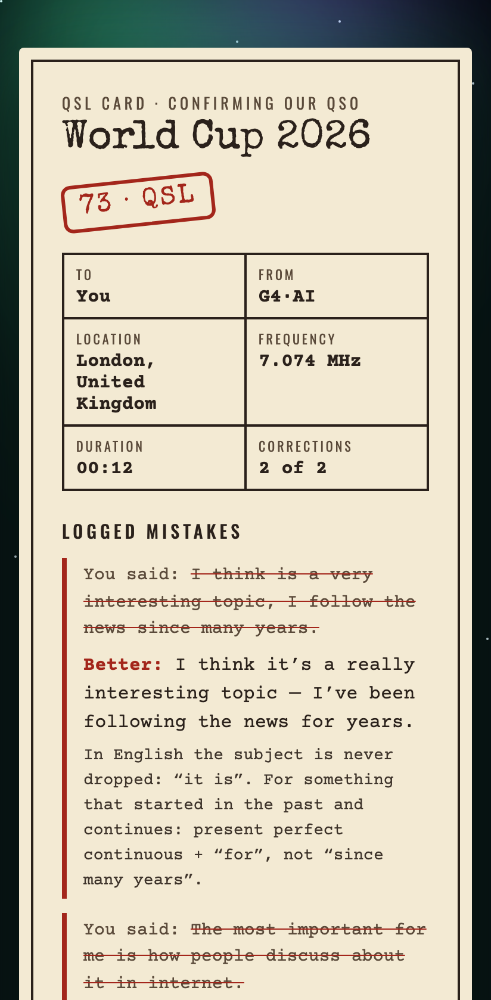

# CQ talk

**Practice spoken English on the air.** Tune a topic, call CQ and talk with an AI radio operator
from the other side of the world. When you sign off, you get a QSL card with your corrections,
new vocabulary and what to practice tomorrow. Free, no sign-up, in your browser.

[](https://github.com/mtorre4580/cq-talk/actions/workflows/ci.yml)
[](https://github.com/mtorre4580/cq-talk/actions/workflows/deploy.yml)
[](https://github.com/mtorre4580/cq-talk/actions/workflows/codeql.yml)
[](./LICENSE)
[](https://mtorre4580.github.io/cq-talk/)

### 👉 [Open CQ talk](https://mtorre4580.github.io/cq-talk/)



<sub>The demo QSO, recorded from the app. [Watch it as a video](docs/media/demo.mp4).</sub>

> In ham radio, _CQ_ means "calling any station". A _QSO_ is a contact, and a _QSL card_ is the
> postcard operators send each other to confirm it.

## How it works

1. **Tune a topic.** Type what you want to talk about, or press one of this week's frequencies.
   The needle swings to the band and the receiver's valves warm up.
2. **Talk, don't type.** Press the desk microphone. An AI operator (`JA1·AI` in Tokyo, `G4·AI` in
   London…) answers in English, half-duplex like a real radio: say "over" to hand the turn back.
   Under each line you say you see a better way to say it, or "✓ copied 5 and 9" when it was right.
3. **Get your QSL card.** Press the microphone again to sign off. The card lists your mistakes
   (what you said, a better version and why), vocabulary to add and what to practice tomorrow.
   Download it as a PDF; every card stays in "My QSLs".

<table>
  <tr>
    <td width="33%"></td>
    <td width="33%"></td>
    <td width="33%"></td>
  </tr>
  <tr>
    <td align="center">Tune a topic</td>
    <td align="center">Talk on the air</td>
    <td align="center">Your QSL card</td>
  </tr>
</table>

### On your phone

Open the link and add it to your home screen: it installs as an app (PWA) and the shell works
offline.

<table>
  <tr>
    <td width="33%"></td>
    <td width="33%"></td>
    <td width="33%"></td>
  </tr>
</table>

## Features

- **A real conversation**: a live operator powered by Claude, with your own Anthropic API key. It
  stays on your topic, asks you questions and keeps its turns short. No key? Try the demo QSO.
- **Speech in and out**: speech recognition in your browser, and an operator voice that sounds
  like it comes through a radio. Use your browser's voice for free, or add an ElevenLabs key for a
  natural voice.
- **Corrections that teach**: each line gets a better version only when it needs one, and the QSL
  card explains why, in your language.
- **A radio that feels real**: a 1940s communications receiver drawn in CSS and SVG, with backlit
  dials, valves that warm up and cool down, and a call screen that splits along an aurora (a nod
  to the film _Frequency_).
- **Three languages for the interface**: Spanish, English and Brazilian Portuguese. The
  conversations are always in English.
- **Accessible**: WCAG 2.2 AA, full keyboard support, a typed fallback when speech is not
  available, and reduced motion respected.

## Privacy

There is no backend. Your API keys stay in your browser (`localStorage`) and are only sent to
`api.anthropic.com` and `api.elevenlabs.io`. A strict Content Security Policy blocks every other
destination. Speech recognition is the browser's own, so it may send audio to the browser vendor.

## Built with

React 19, TypeScript, Vite, Nx, Tailwind CSS v4, the Anthropic SDK (structured outputs), the Web
Speech API, Web Audio (every sound is synthesized) and ElevenLabs. Tested with Vitest, Playwright
and axe; Lighthouse CI and a bundle budget run on every pull request.

## Development

Requires Node 24 (see `.nvmrc`) and pnpm.

```bash
pnpm install
pnpm dev      # http://localhost:4200
```

| Command | What it does |
| --- | --- |
| `pnpm dev` | Development server |
| `pnpm check` | What CI runs: sync check, lint, typecheck, unit tests and build |
| `pnpm e2e` | Playwright + axe against the production build (desktop and phone) |
| `pnpm lhci` | Lighthouse CI |
| `pnpm media` | Regenerates the README screenshots, the demo GIF and video and the social preview (after `pnpm build`; needs ffmpeg) |

The architecture, conventions and design are documented in [CLAUDE.md](CLAUDE.md), and the
delivery plan with every pull request in [docs/PLAN.md](docs/PLAN.md).

## Contributing

Ideas, translations and fixes are welcome. Read [CONTRIBUTING.md](CONTRIBUTING.md) to get started.

## License

[MIT](LICENSE)
